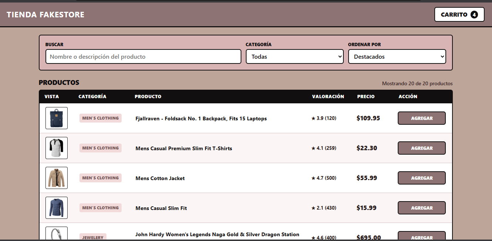
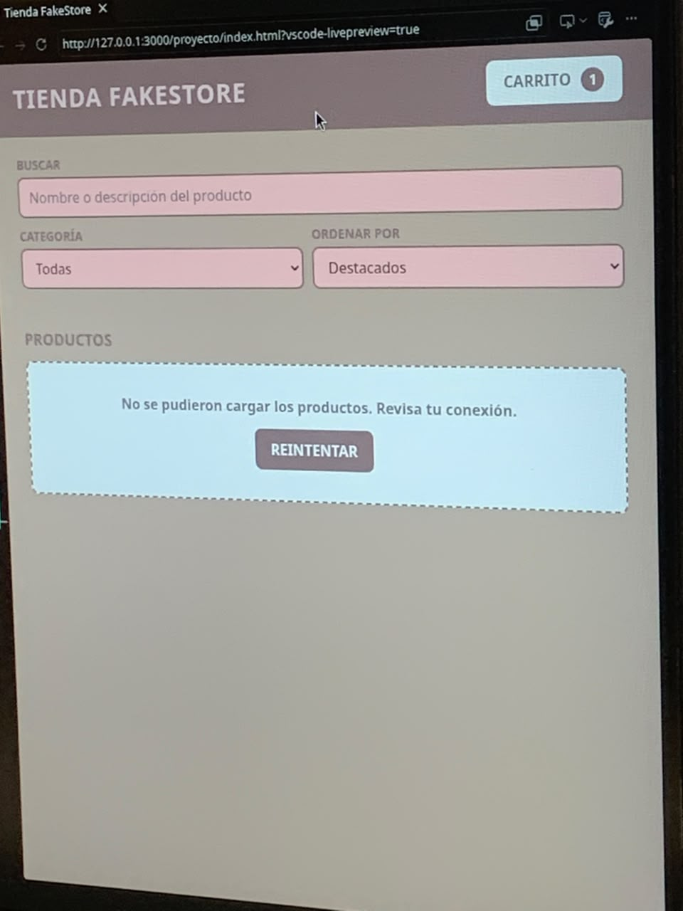

# Tienda FakeStore — Panel de Control y Catálogo

Aplicación web interactiva desarrollada en JavaScript vainilla que consume la API pública [FakeStoreAPI](https://fakestoreapi.com/products), permitiendo la exploración de productos mediante una interfaz tabular responsiva estilo dashboard, filtrado dinámico y gestión de carrito de compras con persistencia de datos.

##  Capturas de Pantalla

| Vista Principal (Matriz) | Carrito de Compras |
| :---: | :---: |
|  |  | 

##  Funcionalidades
- **Consumo de API Asíncrono:** Peticiones HTTP a la API de FakeStore utilizando `fetch` y `async/await`.
- **DOM Dinámico:** Renderizado en tiempo real de filas/tarjetas de producto e información académica/comercial.
- **Carrito Persistente:** Modificación de cantidades, cálculo automático de totales y guardado en `localStorage`.
- **Búsqueda y Filtros:** Barra de búsqueda por coincidencia textual, selector de categoría y ordenamiento multidimensional (precio, alfabético, puntuación).
- **Diseño Responsivo:** Adaptación fluida de vista tabular en escritorio a tarjetas agrupadas en dispositivos móviles.

##  Tecnologías
- **HTML5** (Semántica y accesibilidad)
- **CSS3** (Variables CSS, Flexbox, CSS Grid)
- **JavaScript ES6+** (Módulos, Fetch API, LocalStorage)

##  Estructura del Código
```text
├── css/
│   ├── styles.css
│   └── checkout.css
├── js/
│   ├── api.js
│   ├── storage.js
│   ├── cart.js
│   ├── filters.js
│   ├── ui.js
│   └── app.js
├── evidencias/
│   └── analisis.md
├── index.html
├── checkout.html
└── README.md